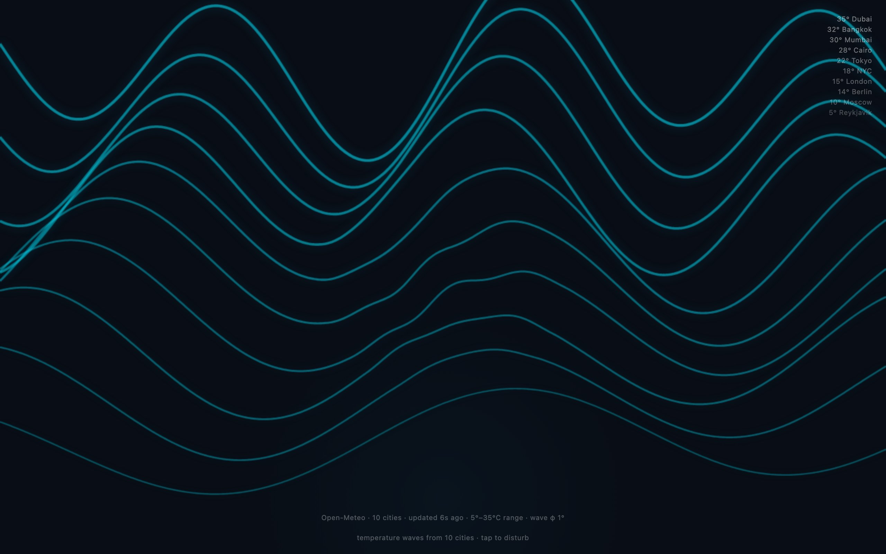

<div align="center">

<h1>swell</h1>

<p><b>Ten cities' temperatures as glowing waves.</b></p>

<p><i>One line per city, from Dubai down to Reykjavik: the warmer it is, the taller, faster and brighter the wave.</i></p>

<h6>


</h6>

<a href="https://parthchandak02.github.io/swell/"><b>Live demo</b></a> ·
<a href="#how-it-works"><b>How it works</b></a> ·
<a href="#run-it"><b>Run it</b></a>

<br><br>

<a href="https://parthchandak02.github.io/swell/"></a>

<sub>Live capture, 22 October 2026, a moment after a click near the centre. The temperatures shown are the built-in fallback values; see the note below.</sub>

</div>

<br>

A one-day sketch from a "creative daily" series: a single `index.html` with no build step and
no dependencies. It asks [Open-Meteo](https://open-meteo.com/) for the current temperature in
ten cities in one batched request, and turns each reading into a line of layered sine waves on
a Canvas 2D background.

## How it works

| Data | Drives |
|---|---|
| City temperature, normalised over −10 to 40 °C | Wave amplitude and frequency |
| Same value | Line brightness and thickness, and how bright the city's label is |
| City order (Dubai, Bangkok, Mumbai, Cairo, Tokyo, NYC, London, Berlin, Moscow, Reykjavik) | Vertical position, top to bottom |

The page refetches every 60 seconds. The bar at the bottom shows the temperature range across
the ten cities and the seconds since the last update. Click or tap anywhere to send a ripple
through the lines near that point.

**Known issue.** Open-Meteo answers a multi-city request with an array of results, but the page
reads `data.current_weather.temperature` as if it were a single object. The read throws, and
the page falls back to fixed values (35, 32, 30, 28, 22, 18, 15, 14, 10, 5 °C) every time, so
the live site currently shows the fallback rather than real temperatures. Mapping over the
array (`data.map(d => d.current_weather.temperature)`) would fix it.

## Run it

```bash
git clone https://github.com/parthchandak02/swell.git
cd swell
python3 -m http.server 8000   # then open http://localhost:8000
```

Any static file server works; the live version is the same file on GitHub Pages.

<br>

<div align="center">
<sub>Built with plain HTML and Canvas 2D. Data from Open-Meteo.</sub>
</div>
